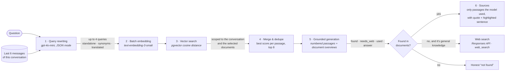
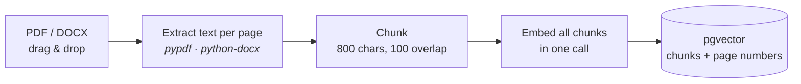
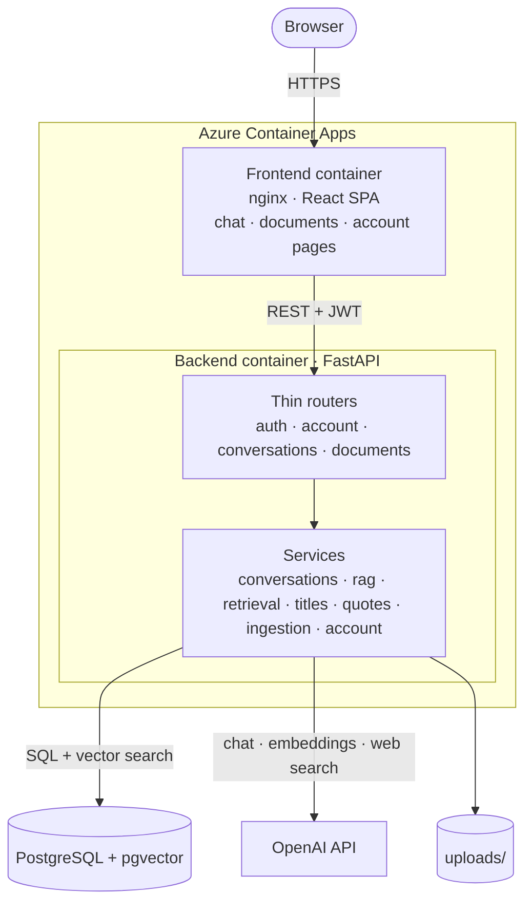

<div align="center">


# DocuMind

**Ask your documents. Get answers you can verify.**

A bilingual (Hebrew / English) knowledge assistant that answers questions from your own PDF and Word files,
cites the exact passage behind every answer, and says so when the answer isn't there.

### [🌐 Try the live app](https://documind-frontend.mangoplant-5d5575b8.italynorth.azurecontainerapps.io/)


</div>

---

## Why DocuMind

Most "chat with your PDF" demos stop at *retrieve a few chunks and hope*. DocuMind treats an answer as a claim that has to be backed up:

- 🔎 **Grounded answers.** The model answers only from retrieved passages and reports which passages it actually used.
- 📌 **Verifiable sources.** Every answer carries footnotes. Click one to open the exact passage, with the most relevant sentence highlighted.
- 🛑 **Honest "I don't know".** If the documents don't contain the answer, it says so instead of making something up. General-knowledge questions fall back to a cited web search.
- 🌐 **Built for Hebrew and English.** Queries are rewritten and translated, so a Hebrew question finds an English document, and the other way around.

The RAG pipeline is written from scratch on the OpenAI SDK and pgvector, with no LangChain or LlamaIndex, so every step is explicit, testable, and tuned.

---

## ✨ Features

| | |
|---|---|
| 💬 **Multiple conversations** | ChatGPT-style sidebar. Create, rename, and delete conversations. Empty ones are cleaned up automatically. |
| 📚 **Documents per conversation** | Each conversation has its own documents (drag & drop PDF / DOCX). Choose which ones a question searches. |
| 🧠 **Smart titles** | After the first answer, the model writes a 2–5 word title in the question's language. A manual rename is never overwritten. |
| 🔖 **Footnotes & source preview** | Inline citation numbers open the source passage, with the matching sentence highlighted. |
| ✅ **"Verified against the document" stamp** | An ink-stamp badge appears only on answers backed by your documents, not on web or small-talk answers. |
| 🌍 **Web fallback** | General-knowledge questions are answered through OpenAI's web search tool, with linked sources. |
| 📋 **One-click copy** | Copy any question or answer (without its sources). Works on non-HTTPS pages too. |
| 🔐 **Accounts** | JWT auth, bcrypt passwords, invite codes, "remember me", login and register tabs, live form validation, password strength meter. |
| 👤 **Profile, settings & quota** | An avatar menu leads to a profile (editable display name, join date, usage stats), settings (change password, delete the account after typing your email to confirm), and today's remaining questions with a progress bar. |
| 🎨 **Designed UI** | A warm "botanical notebook" design system: design tokens, RTL-first layout, accessible components, `prefers-reduced-motion` respected. |

---

## 🧠 How the RAG pipeline works



<details>
<summary><b>Step by step</b></summary>

1. **Query rewriting** ([`llm.py`](backend/app/services/llm.py)). The question and recent history become up to four search queries: the original, a standalone version that resolves follow-ups like *"and what about that?"*, a version with synonyms, and a **translation** (Hebrew ↔ English). This is what makes cross-language retrieval work.
2. **Batch embedding** ([`embeddings.py`](backend/app/services/embeddings.py)). All queries are embedded in **one API call** with `text-embedding-3-small` (1536 dimensions).
3. **Vector search** ([`retrieval.py`](backend/app/services/retrieval.py)). Each query runs a cosine-distance search in **PostgreSQL + pgvector**. Every search is scoped by SQL to the current conversation's documents, optionally narrowed to the documents the user selected.
4. **Merge & dedupe.** Results from all queries are merged. Each passage keeps its best score, duplicates are removed, and the top 8 continue.
5. **Grounded generation.** The model receives numbered passages, the opening of each document (so it can answer questions *about* the documents), and the conversation history. It returns structured JSON: `found`, `needs_web`, `used` (which passages it relied on), and `answer`. The prompt separates *"the document says"* from *"the document doesn't mention"* and allows careful inference.
6. **Sources.** Only the passages listed in `used` become sources, deduplicated per file and page. Each source stores its exact passage plus the sentence closest to the answer, chosen by word overlap with Hebrew prefix normalization and no extra LLM call. The UI highlights it.
7. **Fallbacks.** If nothing is found and the question is general knowledge, the OpenAI Responses API `web_search` tool answers with linked sources. Otherwise the assistant says honestly that the documents don't cover it.

</details>

### Ingestion



Limits (file type, size, documents per conversation and per user) are checked **before** paying for embeddings. Failed uploads roll back both the database rows and the file on disk.

---

## 🛠 Tech stack

| Layer | Technology |
|---|---|
| **LLM** | OpenAI `gpt-4o-mini`: query rewriting, grounded answers in JSON mode, smart titles |
| **Embeddings** | OpenAI `text-embedding-3-small` (1536-d) |
| **Vector store** | PostgreSQL 16 + **pgvector** (cosine distance) |
| **Web search** | OpenAI Responses API with the `web_search` tool and URL citations |
| **Backend** | Python 3.12, **FastAPI**, SQLAlchemy 2, Pydantic v2, Alembic |
| **Auth** | JWT (python-jose), bcrypt, invite codes |
| **Document parsing** | pypdf, python-docx |
| **Frontend** | React 19, React Router 7, Vite, hand-written CSS with design tokens (no UI framework) |
| **Hosting** | **Azure Container Apps** (production): a frontend container (nginx) and a backend container (uvicorn) |
| **Infra** | Docker (multi-stage build), Docker Compose for local development, nginx with SPA fallback |
| **Quality** | pytest with mocked LLM calls, an offline evaluation harness, ESLint |

---

## 🏗 Architecture



**Design principles in the code**

- **Thin routers, logic in services.** Endpoints validate input and delegate to `app/services/*`.
- **Row-level authorization in one place.** `get_owned_conversation` is the only ownership check. Another user's conversation or document returns **404, not 403**, so IDs can't be probed.
- **Fail soft where it's optional.** Query rewriting, web search, and smart titles never break an answer. They log and fall back.
- **Atomic writes.** A question, its answer, and the usage record are committed together, and nothing is saved if the LLM call fails. Smart titles use a conditional `UPDATE … WHERE auto_title`, so a rename made while the model is working is never overwritten.

---

## ☁️ Deployment

DocuMind runs in production on **Azure Container Apps**:
👉 **https://documind-frontend.mangoplant-5d5575b8.italynorth.azurecontainerapps.io/**

| Piece | How it runs |
|---|---|
| **Frontend** | The React app is built into static files and served by **nginx**, with an SPA fallback so deep links like `/c/42` survive a refresh. The API address is baked in at build time (`VITE_API_URL` build argument). |
| **Backend** | FastAPI on uvicorn, from a multi-stage Docker image. Configured through environment variables and secrets: `DATABASE_URL`, `SECRET_KEY`, `OPENAI_API_KEY`, `CORS_ORIGINS` (the frontend's URL). |
| **Database** | PostgreSQL with the **pgvector** extension. |

**Releasing a version that changes the schema**

1. Back up the database.
2. Run the migrations against it: `alembic upgrade head`. Every migration is idempotent and runs in a single transaction.
3. Deploy the backend and frontend images together.

---

## 💻 Run it locally

The same two containers, plus a local PostgreSQL, run with Docker Compose.

### Prerequisites
- Docker and Docker Compose
- An OpenAI API key

### 1 · Configure
Create a `.env` file in the project root:

```env
POSTGRES_PASSWORD=change-me
SECRET_KEY=a-long-random-string
OPENAI_API_KEY=sk-...
INVITE_CODE=            # optional: leave empty to allow open registration
```

### 2 · Build and migrate
```bash
docker compose build
docker compose up -d db
docker compose run --rm backend alembic upgrade head
```

### 3 · Run
```bash
docker compose up -d
```

| Service | URL |
|---|---|
| Web app | http://localhost:3000 |
| API | http://localhost:8000 |
| Interactive API docs | http://localhost:8000/docs |

Sample HR policy documents for trying it out are in [`sample-docs/`](sample-docs).

<details>
<summary><b>Configuration reference</b></summary>

All settings live in [`backend/app/core/config.py`](backend/app/core/config.py) and can be overridden with environment variables.

| Variable | Default | Purpose |
|---|---|---|
| `CHAT_MODEL` | `gpt-4o-mini` | Answers and smart titles |
| `WEB_MODEL` | `gpt-4o-mini` | Web-search fallback |
| `DAILY_QUESTION_LIMIT` | `30` | Questions per user per 24h, across all conversations |
| `MAX_CONVERSATIONS_PER_USER` | `50` | |
| `MAX_DOCS_PER_CONVERSATION` | `10` | |
| `MAX_DOCS_PER_USER` | `50` | |
| `MAX_UPLOAD_MB` | `5` | |
| `ACCESS_TOKEN_EXPIRE_MINUTES` | `60` | Regular sign-in |
| `REMEMBER_ME_EXPIRE_DAYS` | `30` | "Remember me" sign-in |
| `TITLE_TIMEOUT_SECONDS` | `5` | Upper bound for smart-title generation |
| `CORS_ORIGINS` | `http://localhost:5173` | Comma-separated |

</details>

<details>
<summary><b>Behind a TLS-inspecting proxy?</b></summary>

If your network inspects HTTPS traffic (corporate proxies, filters), add its root certificate to `backend/certs/` and run the backend with `update-ca-certificates` before `uvicorn`, so calls to OpenAI can be verified.

</details>

---

## 🧪 Testing

The test suite runs against a **real PostgreSQL** database, so it exercises pgvector, cascades, and the Alembic migrations themselves. Every OpenAI call is mocked.

```bash
docker compose exec db createdb -U postgres documind_test
docker compose run --rm --no-deps -v "$(pwd)/backend:/app" \
  -e TEST_DATABASE_URL="postgresql+psycopg2://postgres:<password>@db:5432/documind_test" \
  backend sh -c "pip install -q pytest httpx && python -m pytest -q"
```

A safety check refuses to run unless the database name ends in `_test`. Without `TEST_DATABASE_URL`, the database tests are skipped.

**What's covered:** row-level authorization (404 on another user's data), cascade deletes including files on disk, conversation ordering and limits, the per-user daily quota (which survives deleting a conversation), history scoped to the current conversation, retrieval scoped to the selected documents, source quotes and highlighting, smart titles (first answer only, failure fallback, a manual rename is never overwritten), "remember me" token lifetimes, the account endpoints (display name, usage stats, password change, account deletion that removes only that user's data and files), and a **data-preserving migration** from the old single-chat schema, including downgrade and upgrade again.

### Evaluating answer quality

[`evaluation/run_eval.py`](evaluation/run_eval.py) runs a labeled question set ([`questions.json`](evaluation/questions.json), 61 questions in Hebrew) through the same `answer_question` pipeline the API uses, with web search disabled:

| Question type | Correct when |
|---|---|
| `answerable` | The answer is found **and** contains the expected keywords |
| `unanswerable` | The assistant does **not** claim to have found an answer |
| `meta` | It answers questions about the documents themselves |
| `chitchat` | It responds politely without citing sources |

It also reports **document-level and passage-level retrieval hit rates** and latency, so changes to prompts, chunking, or retrieval can be measured instead of guessed.

```bash
cd evaluation && python run_eval.py
```

---

## 📁 Project structure

```
DocuMind/
├── backend/
│   ├── app/
│   │   ├── api/          # Thin FastAPI routers + auth dependencies
│   │   ├── core/         # Settings, database, security (JWT, bcrypt)
│   │   ├── models/       # SQLAlchemy models (users, conversations, messages, documents, chunks)
│   │   ├── schemas/      # Pydantic request/response models
│   │   └── services/     # rag · retrieval · llm · embeddings · ingestion · titles · quotes · account …
│   ├── alembic/          # Idempotent schema migrations (0001 baseline → 0004)
│   └── tests/            # pytest suite (real Postgres, mocked OpenAI)
├── frontend/
│   ├── public/           # Site icon
│   └── src/
│       ├── account/      # Profile, settings and quota pages + the signed-in user context
│       ├── components/   # Reusable UI: TextField, Tabs, DropdownMenu, FileDropZone, CopyButton, ProgressBar …
│       ├── hooks/        # useConversationDocuments, useCurrentUser, useApiData, useAsyncAction, useFormFields
│       └── styles/       # Design tokens + component styles
├── evaluation/           # Labeled question set and evaluation scripts
├── sample-docs/          # Example HR policies to try the assistant with
└── docker-compose.yml
```

---

## 🔌 API at a glance

| Method | Endpoint | Description |
|---|---|---|
| `POST` | `/auth/register` · `/auth/login` | Create an account · get a JWT (optional `remember`) |
| `GET` · `PATCH` | `/auth/me` | The signed-in user · update the display name |
| `GET` | `/auth/me/usage` | Documents, conversations and questions, plus today's quota |
| `POST` | `/auth/me/password` | Change the password (requires the current one) |
| `DELETE` | `/auth/me` | Delete the account and all its data (requires typing the email) |
| `GET` · `POST` | `/conversations` | List (most recent first) · create |
| `PATCH` · `DELETE` | `/conversations/{id}` | Rename · delete (`?if_empty=true` deletes only an empty one) |
| `GET` | `/conversations/{id}/messages` | Conversation history with sources |
| `POST` | `/conversations/{id}/ask` | Ask a question (optional `document_ids`). Returns the answer, sources, and the current title |
| `GET` · `POST` | `/conversations/{id}/documents` | List · upload a PDF / DOCX |
| `DELETE` | `/documents/{id}` | Delete a document and its file |

Full interactive documentation: **`/docs`** (Swagger UI, generated by FastAPI).

---

<div align="center">

Built with care by <a href="https://github.com/SaritNerya">Sarit Nerya</a>

</div>
